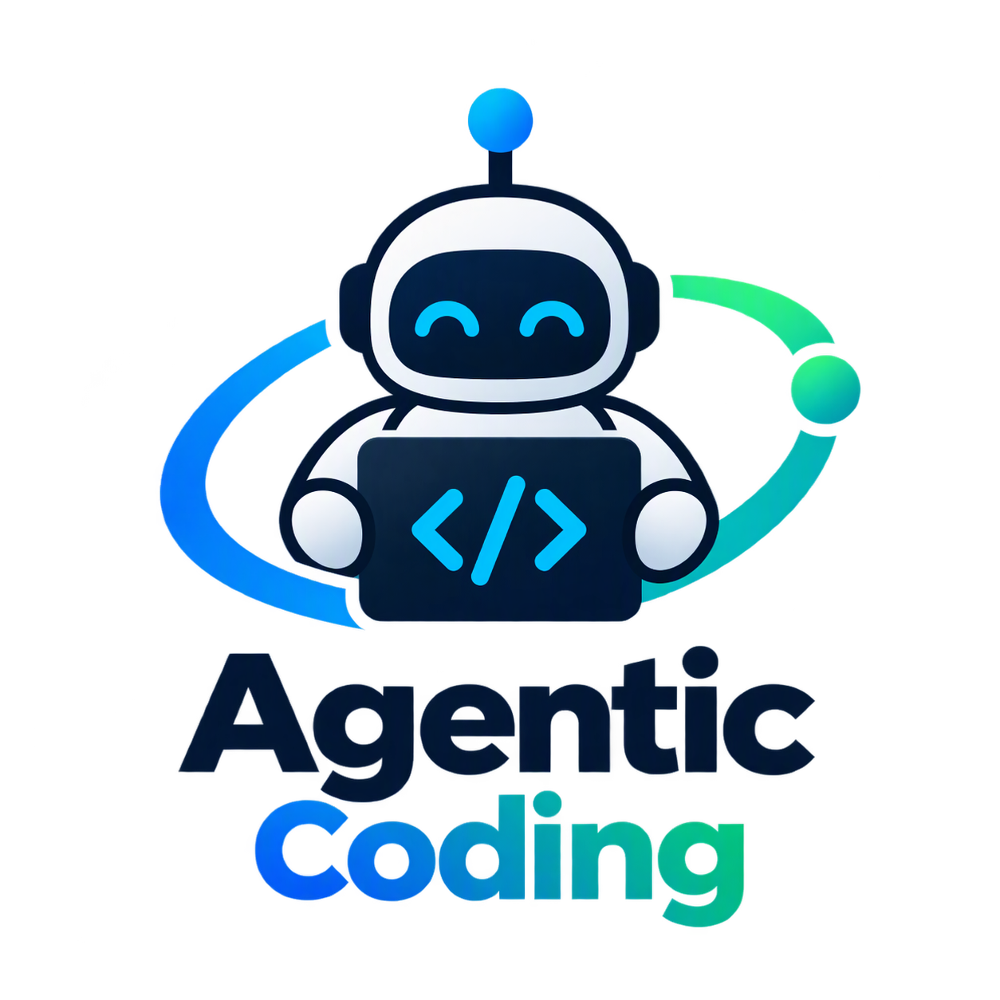
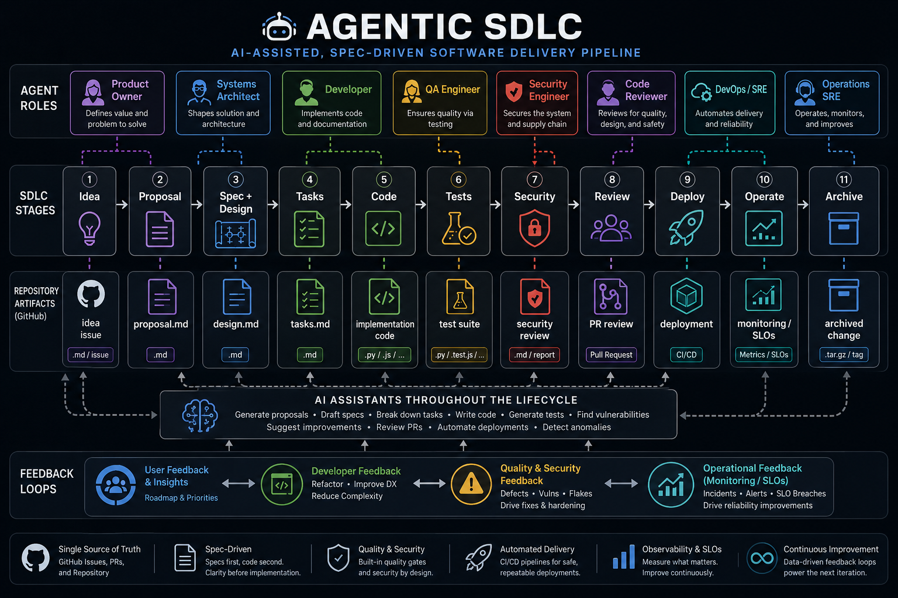

# GitHub Copilot Software Fabric - Autonomous SDLC and Workshops

## Agentic-Coding



This repository is a hands-on workshop and reference implementation for
GitHub Copilot, coding agents, spec-driven development, and an agentic
issue-to-delivery workflow. It contains beginner, intermediate, and advanced
labs plus reusable Software Fabric agents, instructions, skills, OpenSpec
content, workflows, and MCP configuration.

## Start here

The shortest path for a first-time participant is:

1. Make sure your GitHub account has an active Copilot entitlement.
2. Fork or clone this repository.
3. Use GitHub Codespaces, a local devcontainer, or a native workstation setup.
4. Authenticate GitHub and any optional external services.
5. Complete [Lab 01](lab/01-beginner/01-copilot-foundations.md).

### 1. GitHub and Copilot prerequisites

You need:

- A GitHub account.
- An active [GitHub Copilot
  subscription](https://docs.github.com/copilot/about-github-copilot/plans-for-github-copilot)
  through an individual plan or an organization/enterprise plan.
- Permission from your organization to use Copilot if your seat is managed by
  an organization. An administrator may also need to enable the Copilot coding
  agent, MCP servers, and repository access.
- [VS Code Insiders](https://code.visualstudio.com/insiders/) with the
  [VS Code Agents application](https://code.visualstudio.com/docs/copilot/agents-app)
  for the workshop's agent-first workflow.
- Git. GitHub CLI (`gh`) is included in the devcontainer and is recommended
  for local authentication checks.

You can run Lab 01 with Copilot Chat and inline assistance. The autonomous
issue-to-pull-request features additionally require the coding agent to be
available to your account or organization and allowed on the target repository.
Check your
[Copilot settings](https://docs.github.com/en/copilot/managing-copilot/managing-github-copilot-in-your-organization)
before troubleshooting repository automation.

### 2. Fork or clone

Fork the repository on GitHub if you want to keep your workshop changes,
create issues, run Actions, or exercise pull-request workflows. Otherwise,
clone it read-only for local experimentation.

```powershell
cd C:\repos
git clone https://github.com/<your-user>/Agentic-Coding.git
cd Agentic-Coding
```

macOS or Linux shell:

```bash
mkdir -p ~/repos
cd ~/repos
git clone https://github.com/<your-user>/Agentic-Coding.git
cd Agentic-Coding
```

Sign in before using GitHub CLI or Copilot CLI:

```bash
gh auth login
gh auth status
```

If you use the coding-agent workflows in a fork, enable GitHub Actions in the
fork and confirm that the workflow token has the repository permissions needed
for the task.

### 3. Where credentials belong

Never commit tokens, passwords, private endpoints, or client secrets to this
repository. Do not place real values in `.mcp.json`, agent Markdown files,
workflow YAML, or lab files.

| Situation | Store credentials here |
| --- | --- |
| Interactive local use of GitHub | Run `gh auth login`; GitHub CLI stores the credential in the operating-system credential store |
| VS Code and GitHub Copilot | Use the VS Code sign-in flow; do not paste a Copilot token into configuration |
| GitHub Actions | **Repository Settings → Secrets and variables → Actions → New repository secret** |
| GitHub Codespaces | **Repository Settings → Codespaces → Secrets → New repository secret**, or your GitHub user-level Codespaces secrets for values shared across repositories |
| Azure MCP / Azure CLI | Run `az login`; optionally select the intended subscription with `az account set --subscription <name-or-id>` |
| A custom MCP server | Keep the token in an environment variable, IDE secret input, Codespaces secret, or deployment secret store, then reference it from `.mcp.json` |
| Shared-asset sync to a non-public upstream | Add `AGENTIC_SHARED_TOKEN` as an Actions secret; the current public `agentic-shared` flow falls back to `GITHUB_TOKEN` |

Local examples:

```powershell
# PowerShell - current terminal only
$env:SECURITY_MCP_TOKEN = "<token>"
```

```bash
# macOS/Linux - current terminal only
export SECURITY_MCP_TOKEN="<token>"
```

Store a persistent local secret in your operating-system credential or secret
manager rather than a tracked shell script. The repository ignores `.env*`
files, but ignore rules are not a secret-management system: do not rely on a
local `.env` file for high-value credentials.

### 4. Choose an environment

All three paths are supported:

| Environment | Best for | Extra local prerequisite |
| --- | --- | --- |
| GitHub Codespaces | Fastest onboarding with no local Docker or tool installation | Codespaces access/quota |
| Local devcontainer | Reproducible Linux toolchain on Windows or macOS | Docker-compatible container runtime and the Dev Containers extension |
| Native workstation | Direct host development and no container | Install the toolchain listed below |

The active `.devcontainer/devcontainer.json` is the source of truth. It builds
from Microsoft's public
`mcr.microsoft.com/devcontainers/base:ubuntu` image, then installs pinned
Dev Container Features and the repository's `workshop-tools` feature.

### 5. Verify the environment

Inside Codespaces or the devcontainer, run:

```bash
git --version
gh --version
copilot --version
python3.14 --version
dotnet --version
dab --version
aspire --version
openspec --version
docker --version
bash scripts/devcontainer-smoke-check.sh
```

`docker --version` verifies the Docker-outside-of-Docker client. Docker-backed
workloads also need a usable host daemon. The smoke check reports individual
passes, warnings, and failures rather than hiding missing tools.

## GitHub Codespaces

Codespaces is the easiest option for a new participant:

1. Open your fork or this repository on GitHub.
2. Select **Code → Codespaces → Create codespace on main**.
3. Choose a machine size and wait for the repository container to be created.
4. After VS Code loads, wait for the post-create command to finish.
5. Run the verification commands above.

Benefits:

- No Docker Desktop, Python, .NET, Node.js, DAB, or OpenSpec installation on the
  host.
- The same `.devcontainer/devcontainer.json` used by local participants.
- Forwarded ports appear in the **Ports** tab.
- Fork and repository secrets can be supplied as Codespaces secrets without
  writing them to disk.

The first creation or a full rebuild can take several minutes. Codespaces pulls
the Microsoft base image, resolves container features, runs package upgrades,
and installs Python, .NET, Aspire, Copilot CLI, DAB, Trivy, and OpenSpec.
Subsequent reconnects are normally faster, especially while the Codespace is
preserved.

Do not configure Codespaces to use a machine-specific local mount. Use the
default `.devcontainer/devcontainer.json`.

## Local devcontainer on Windows or macOS

### Prerequisites

- VS Code Insiders.
- The
  [Dev Containers extension](https://marketplace.visualstudio.com/items?itemName=ms-vscode-remote.remote-containers).
- A Docker-compatible runtime:
  - macOS: Docker Desktop.
  - Windows: Docker Desktop with the WSL 2 backend, or the supported WSL
    container workflow documented in
    [the devcontainer workflow guide](.devcontainer/WORKFLOW.md).
- Enough disk space and time for the first build.

### Open the container

1. Open the cloned repository in VS Code Insiders.
2. Run **Dev Containers: Reopen in Container** from the Command Palette.
3. Wait for the build and `.devcontainer/post-create.sh` to complete.
4. Run the verification commands in **Verify the environment**.

The active workflow intentionally uses the native Microsoft Dev Container
base image instead of depending on a pre-published repository image in GHCR.
The benefits are transparent Microsoft-maintained base contents, no private
repository-image pull permission, and a configuration that contributors can
rebuild from source. The trade-off is a longer first build and every full
rebuild.

The optional `.devcontainer/devcontainer-prebuilt.json` and workflow helpers
remain development utilities; they are not the default participant path.

## Native Windows or macOS setup

Use the native path when you do not want Docker. Install:

1. VS Code Insiders and the VS Code Agents application.
2. Git and GitHub CLI.
3. Node.js LTS (Node.js 20.19 or newer is required by the OpenSpec package).
4. Python 3.14.
5. The .NET 10 SDK; .NET 8 is also available in the devcontainer for exercises
   that require it.
6. Data API Builder:

   ```bash
   dotnet tool install --global Microsoft.DataApiBuilder
   ```

7. The
   [Aspire CLI](https://learn.microsoft.com/dotnet/aspire/cli/install) for
   Aspire-specific labs.
8. GitHub Copilot CLI by following the
   [GitHub Copilot CLI installation guide](https://docs.github.com/en/copilot/how-tos/copilot-cli/install-copilot-cli)
   if you want the same command-line agent experience as the container.
9. Optional external-service CLIs:
   - Azure CLI for Azure MCP and Azure exercises.
   - A compatible local Docker runtime for Aspire sidecars, SQL Server,
     Testcontainers, Docker Scout, and container exercises.

Verify the host:

```bash
git --version
gh auth status
node --version
npm --version
dotnet --version
python3 --version        # macOS
py -3.14 --version       # Windows
dab --version
aspire --version
copilot --version
openspec --version
```

On Windows PowerShell, create and activate the Python environment with:

```powershell
py -3.14 -m venv .venv
.\.venv\Scripts\Activate.ps1
python -m pip install -r src/requirements-dev.txt
```

On macOS:

```bash
python3.14 -m venv .venv
source .venv/bin/activate
python -m pip install -r src/requirements-dev.txt
```

## Make Lab 01 work

Lab 01 is deliberately framework-free. It creates one self-contained HTML file;
it does not require a backend, Node project, database, or OpenSpec change.

1. Open the repository in the Agents application.
2. Trust the workspace if prompted.
3. Open [Lab 01](lab/01-beginner/01-copilot-foundations.md).
4. Ask Copilot to create `src/hello-copilot.html` using the suggested prompt.
5. Review the generated diff before accepting it.
6. From the repository root, serve the static page:

   ```bash
   python3.14 -m http.server 8000 --directory src
   ```

   On a native Windows installation, use `py -3.14` instead of `python3.14`.

7. Open `http://localhost:8000/hello-copilot.html`.
   - In Codespaces, open port `8000` from the **Ports** tab if VS Code does not
     offer to open it automatically.
8. Confirm the heading, paragraph, and interactive button or link are visible.
9. Stop the server with `Ctrl+C`.

If port 8000 is already occupied, choose another port consistently in the
command and browser URL.

## Learning goals and roadmap

- Build practical Copilot habits for everyday coding.
- Move from prompt quality and pair programming to agentic workflows.
- Use tests and review loops to validate generated changes.
- End with an automated issue-to-Copilot flow where tasks can be handled
  autonomously.

Workshop tracks:

- **Beginner:** prompt crafting, chat context, and safe code generation.
- **Intermediate:** tests, refactoring, review loops, and spec-driven work.
- **Advanced:** CI/CD and autonomous issue handling.

See the [workshop roadmap](doc/workshop-roadmap.md) and
[participant setup guide](doc/setup.md).

## Agentic SDLC Spec-driven diagram

```mermaid
flowchart LR
    classDef stage fill:#1f2937,stroke:#60a5fa,color:#e5e7eb,stroke-width:1px;
    classDef role fill:#111827,stroke:#10b981,color:#d1fae5,stroke-width:1px;
    classDef gate fill:#111827,stroke:#f59e0b,color:#fde68a,stroke-dasharray: 5 5;

    subgraph PO_LANE [Product Owner]
        direction LR
        A["Idea<br/>idea issue"]
        B["Proposal<br/>proposal.md"]
    end

    subgraph SA_LANE [Systems Architect]
        direction LR
        C["Spec + Design<br/>design.md"]
    end

    subgraph DEV_LANE [Developer]
        direction LR
        D["Tasks<br/>tasks.md"]
        E["Code<br/>implementation"]
    end

    subgraph QA_LANE [QA Engineer]
        direction LR
        F["Tests<br/>test suite"]
    end

    subgraph SEC_LANE [Security Engineer]
        direction LR
        G["Security<br/>review"]
    end

    subgraph REV_LANE [Code Reviewer]
        direction LR
        H["PR Review"]
    end

    subgraph SRE_LANE [DevOps / SRE]
        direction LR
        I["Deploy"]
    end

    subgraph OPS_LANE [Operations SRE]
        direction LR
        J["Operate<br/>monitoring / SLOs"]
        K["Archive<br/>change"]
    end

    A --> B --> C --> D --> E --> CI --> F --> SEC_GATE --> G --> PR_GATE --> H --> CD --> I --> J --> K
    CI{{"CI Pipeline<br/>build + test"}}
    SEC_GATE{{"Security Gate<br/>scan + policy"}}
    PR_GATE{{"PR Approval<br/>review gate"}}
    CD{{"CD Pipeline<br/>release"}}
    J -- "telemetry and insights" --> A

    class A,B,C,D,E,F,G,H,I,J,K stage;
    class PO_LANE,SA_LANE,DEV_LANE,QA_LANE,SEC_LANE,REV_LANE,SRE_LANE,OPS_LANE role;
    class CI,SEC_GATE,PR_GATE,CD gate;
```





## OpenSpec CLI

This repository is already initialized as an OpenSpec project. The OpenSpec
CLI is the authoritative interface for inspecting, validating, applying, and
archiving changes. Repository command skills are adapters that call the CLI
workflow; they are not a replacement for it.

Verify the existing checkout:

```bash
openspec --version
openspec context --json
openspec doctor
openspec list --json
```

Do not run `openspec init` again in this repository unless you intentionally
need to migrate or repair its OpenSpec schema. For a new project, install and
initialize the CLI:

```bash
npm install -g @fission-ai/openspec@latest
cd <new-repository>
openspec init .
openspec context --json
```

Use the CLI to inspect and apply a change:

```bash
openspec status --change <slug> --json
openspec show --change <slug> --json
openspec instructions proposal --change <slug> --json
openspec instructions apply --change <slug> --json
openspec validate
openspec archive <slug> --json -y
```

Only archive after the repository's planning, test, security, review, and
operational gates pass. The repository skills provide higher-level workflows:

- `openspec-propose`
- `openspec-apply-change`
- `openspec-verify-change`
- `openspec-sync-specs`
- `openspec-archive-change`

See [OpenSpec workflow
instructions](.github/instructions/openspec-workflow.instructions.md) for the
exact repository contract.

## Shared agentic assets

Reusable Software Fabric workflows, agents, instructions, and skills are
maintained in [`ralphke/agentic-shared`](https://github.com/ralphke/agentic-shared).
The local `.agentic-shared.yml` manifest currently pins release **`v1.4.0`**.

This consumer repository owns workshop content, local specifications, OpenSpec
changes, implementations, and repo-specific automation. The shared repository
owns reusable cross-project assets. Keep the concerns separate:

- Use this repository's default `openspec/` root for workshop and product work.
- Use `--store agentic-shared` only when intentionally working on the shared
  repository's OpenSpec content.
- Do not hard-code the shared repository's checkout path into the manifest.

Register a separate local checkout as an OpenSpec store when needed:

```bash
cd ..
git clone https://github.com/ralphke/agentic-shared.git agentic-shared
cd Agentic-Coding
openspec store register "../agentic-shared" --id agentic-shared --yes
openspec store doctor agentic-shared
openspec context --json --store agentic-shared
openspec list --json --store agentic-shared
```

Validate and synchronize a tagged release locally:

```bash
python .github/scripts/validate_agentic_shared_manifest.py .agentic-shared.yml
python .github/scripts/sync_agentic_shared.py --target-version v1.4.0
```

Use `--force` only to replace unresolved, manifest-managed consumer files. It
does not bypass `protected_paths`, and the resulting diff must still be
reviewed:

```bash
python .github/scripts/sync_agentic_shared.py --target-version <tag> --force
```

For a reviewed GitHub-hosted update, dispatch
`.github/workflows/agentic-shared-sync.yml`; it creates a pull request rather
than pushing directly to `main`.

Copilot discovers repository customizations from:

- Agents: `.github/agents/`
- Instructions: `.github/instructions/`
- Skills: `.github/skills/<name>/SKILL.md`
- MCP integrations: `.mcp.json`
- Workflows: `.github/workflows/`

The numbered Markdown files in `.github/prompts/` are chronological workshop
history, not active slash commands. Operational workflows are exposed through
skills and the OpenSpec CLI.

## Add an MCP server for security tasks

The repository's portable MCP configuration is `.mcp.json`. The security
agent is defined in
`.github/agents/security-engineer.agent.md` and currently uses the GitHub and
OpenSpec tools in its explicit `tools` allow-list. Add a security server in two
places: register it and grant only its required tools to the agent.

### 1. Register the server

Add the server under `mcpServers` in `.mcp.json`. Pin an npm package version
where possible and pass credentials through environment variables rather than
literal values. A local/stdio example:

```json
{
  "mcpServers": {
    "security-mcp": {
      "type": "stdio",
      "command": "npx",
      "args": [
        "-y",
        "@your-org/security-mcp@1.2.3"
      ],
      "env": {
        "SECURITY_MCP_TOKEN": "${env:SECURITY_MCP_TOKEN}"
      }
    }
  }
}
```

For an HTTP server, register its URL and use the authentication mechanism
supported by that server. Prefer OAuth, a short-lived token, or a
prompted/secret-backed variable. Never copy a long-lived bearer token into
`.mcp.json`.

### 2. Grant least-privilege access to the security agent

Update the `tools` front matter in
`.github/agents/security-engineer.agent.md`:

```yaml
tools:
  - execute
  - read
  - search
  - web
  - todo
  - github/*
  - openspec-filesystem/*
  - security-mcp/*
```

Replace `security-mcp/*` with the server's exact tool prefix or, preferably,
its individual approved tools. The provider name must match the server name in
`.mcp.json`. Do not use unrestricted access unless the server is intentionally
designed for it and the security risk has been reviewed.

### 3. Reload and verify

1. Reopen VS Code, run **Developer: Reload Window**, or restart the Codespace
   and Copilot session after changing `.mcp.json`.
2. Run **MCP: List Servers** from the Command Palette and confirm the server
   reaches a running or connected state.
3. Open **View → Output** and select the MCP log when startup or authentication
   fails. Confirm the failure is not a missing environment variable.
4. Start a new chat, select the **Security Engineer Agent**, and open the tool
   picker. The expected security tools should appear.
5. Run a read-only smoke test first, for example a vulnerability-database
   lookup or server metadata request. Confirm that writes, deployments, and
   destructive commands are not exposed unless explicitly required.
6. Invoke the security-review skill on a small test change and verify the
   resulting evidence identifies the MCP server and the exact tool calls used.

A configured entry is not proof of activation. Successful server discovery,
authenticated startup, visible agent tools, and one representative tool call
are all required before relying on the integration as a security gate.

## Repository layout

- `README.md`: first-time setup and high-level workflow.
- `doc/`: workshop guides, facilitator notes, and environment documentation.
- `lab/`: participant exercises by level.
- `src/`: workshop source exercises and Python development dependencies.
- `openspec/`: source-of-truth specifications and in-flight changes.
- `.devcontainer/`: active container configuration and build helpers.
- `.github/agents/`: Software Fabric personas.
- `.github/skills/`: operational workflows.
- `.github/instructions/`: repository-wide and path-specific Copilot guidance.
- `.github/workflows/`: CI, security, OpenSpec, and task-routing automation.
- `tests/`: repository and devcontainer validation.

## References

- [VS Code Agents application](https://code.visualstudio.com/docs/copilot/agents-app)
- [Set up GitHub Copilot in VS Code](https://code.visualstudio.com/docs/copilot/setup)
- [GitHub Copilot CLI](https://docs.github.com/en/copilot/how-tos/copilot-cli)
- [OpenSpec](https://github.com/Fission-AI/OpenSpec)
- [Dev Containers](https://containers.dev/)
- [GitHub Codespaces](https://docs.github.com/codespaces)
- [Awesome Copilot Learning Hub](https://awesome-copilot.github.com/learning-hub/)
