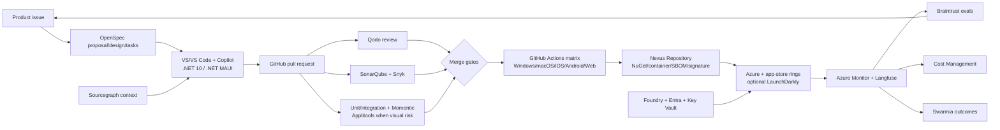
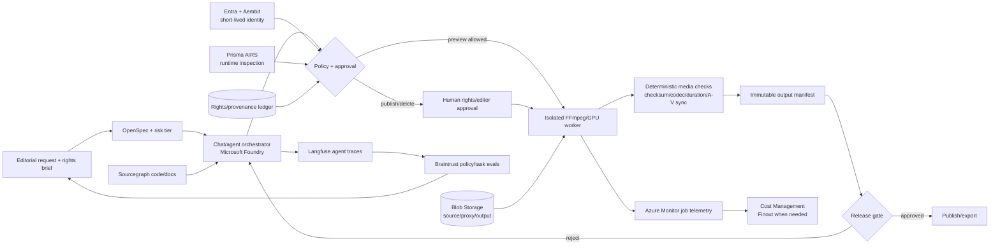

# Operational AI Software Engineering Platform Design

**Evaluation date:** 2026-09-19  
**Decision status:** Recommended architecture; procurement, security proof of concept, and legal sign-off remain gated  
**Primary inventory:** [vibe2live](vibe2live)

## 1. Executive recommendation

Adopt one **Microsoft/GitHub-centered shared engineering platform** with a small number of specialist controls and two scenario profiles.

**Shared core:** GitHub Enterprise and Copilot, OpenSpec, Sourcegraph, Qodo, SonarQube, GitHub Actions, Nexus Repository, Snyk, Microsoft Entra ID, Microsoft Foundry, Azure Monitor/Application Insights, Langfuse, Braintrust, Microsoft Cost Management, and Swarmia.

**Scenario 1 extensions:** .NET 10/.NET MAUI, Visual Studio and VS Code, Azure Blob Storage, Momentic, Applitools Eyes, and LaunchDarkly when independent runtime release control is justified.

**Scenario 2 extensions:** Azure Blob Storage with immutable/versioned rights metadata, isolated FFmpeg/GPU workers, Aembit for non-human identity, Prisma AIRS for independent runtime protection, Momentic for editor workflows, and Finout only after multi-cloud or showback complexity exceeds native Cost Management.

This architecture favors one primary owner per capability. Complementary products are retained only where they enforce a different control plane: deterministic code quality versus supply-chain security, human/workload identity versus AI runtime inspection, application telemetry versus agent traces, and functional tests versus visual assertions.

## 2. Assumptions and scenario requirements

### Shared assumptions

- GitHub Enterprise is the source, collaboration, audit, and integration hub.
- Microsoft Entra ID is the human identity provider; workload identities use OIDC or managed identity where available.
- Microsoft Foundry is the governed model and agent resource boundary; direct model-provider keys are prohibited in production workloads.
- OpenTelemetry is the telemetry contract, avoiding hard coupling between instrumentation and backend.
- Product prices from the source inventory are planning indicators only. Public prices are rechecked at procurement; quote-based items remain `TBD`.
- A proof of concept must establish precision, latency, data retention, residency, exportability, and operating cost before specialist tools become mandatory.

### Scenario 1: cross-device product engineering

- Native clients target Android, iOS, macOS, and Windows from a shared .NET MAUI codebase; web uses ASP.NET Core plus the selected web UI framework.
- Rich-media operations include upload, metadata extraction, thumbnails/proxies, playback, sync, and accessibility. Heavy processing occurs server-side.
- iOS/macOS builds require controlled macOS runners and Apple signing infrastructure.
- Release trains differ by channel: web/service progressive rollout and rollback; app-store releases use staged rings and remote feature controls.
- Entra ID, Microsoft Foundry, Azure-hosted OpenAI models, Azure Storage, and Azure Monitor are preferred integration surfaces.

### Scenario 2: governed agentic video engineering

- Source media, proxies, project timelines, render outputs, rights records, and audit evidence are separate asset classes.
- Render jobs run in isolated, ephemeral workers with network and filesystem policy, signed input manifests, and deterministic output manifests.
- Agent actions are risk-tiered. Suggestion and preview may be autonomous; overwrite, deletion, rights change, external publication, and irreversible render promotion require human approval.
- Media metadata is untrusted input and is scanned before entering prompts or tool arguments.
- Rights, consent, provenance, regional storage, retention, legal hold, moderation, and deletion workflows are release-blocking requirements.

## 3. Capability model and definitions

| # | Capability | Primary owner | Boundary |
| ---: | --- | --- | --- |
| 1 | Context management | Sourcegraph | Cross-repository search, code intelligence, agent retrieval; GitHub remains source of truth. |
| 2 | Code review | Qodo | Context-aware AI review and standards; humans retain merge authority. |
| 3 | Verification | SonarQube | Deterministic quality/SAST quality gate; unit, integration, and E2E tests remain code-owned. |
| 4 | Delivery | GitHub Actions | Build/test/release orchestration. Harness is a scale-up option for complex multi-environment CD. |
| 5 | Artifact management | Nexus Repository | NuGet, npm, containers, models, SBOMs, signatures; not source video. |
| 6 | Application security | Snyk | SCA, container and IaC risk; disable duplicate SAST where SonarQube owns it. |
| 7 | Runtime security | Microsoft Foundry guardrails; Prisma AIRS for high-risk independent enforcement | Model/agent input, output, tool-call, and runtime controls. Aembit owns non-human access identity, not content security. |
| 8 | Observability | Azure Monitor/Application Insights | Operational system of record. Langfuse supplies agent-native traces through OpenTelemetry. |
| 9 | AI evaluation | Braintrust | Versioned datasets, offline/online scoring, and release regression gates. |
| 10 | FinOps | Microsoft Cost Management | Azure allocation, budgets, anomaly alerts, exports. Finout is conditional for multi-cloud/AI showback. |
| 11 | Engineering intelligence | Swarmia | DORA, investment balance, AI impact, and team-level experience signals. No individual ranking. |

**Foundation:** GitHub Enterprise, GitHub Copilot, OpenSpec, Visual Studio/VS Code, Entra ID, Azure Key Vault, Microsoft Foundry, Azure Policy, Azure Blob Storage, OpenTelemetry, and Power BI/Fabric for executive reporting where already licensed.

## 4. Candidate inventory extracted from the source

| Capability | Credible candidates in `vibe2live` | Disposition summary |
| --- | --- | --- |
| Context | Sourcegraph, Augment Context Engine, DeepWiki | Sourcegraph selected; Augment PoC alternative; DeepWiki optional onboarding aid. |
| Review | Qodo Merge, Greptile, CodeRabbit, GitHub native | Qodo selected; Greptile alternative; GitHub native retained for required checks; CodeRabbit not selected. |
| Verification | SonarQube, GitHub Code Security | SonarQube quality owner; GitHub security controls remain platform controls. |
| Application validation | Momentic, mabl, Applitools, Diffblue | Momentic selected for E2E; Applitools conditional for visual fidelity; mabl alternative; Diffblue rejected because the target is .NET, not Java. |
| Delivery | GitHub Actions, Harness, Buildkite, CircleCI, LaunchDarkly | Actions selected; Harness/LaunchDarkly conditional; Buildkite for exceptional self-hosted/GPU scale; CircleCI not selected. |
| Artifacts | Nexus Repository/Sonatype, JFrog, Docker, Chainguard | Nexus selected; GitHub Packages is MVP option; Chainguard/Docker hardened content is a supplier, not the repository. |
| AppSec | Snyk, Semgrep, Endor Labs, GitHub Code Security | Snyk selected; Endor conditional for reachability/noise; Semgrep alternative; GitHub native controls retained where licensed. |
| Runtime security | Prisma AIRS, Check Point AI Guardrails, Aembit | Foundry baseline; Prisma selected for high-risk runtime; Aembit identity complement; Check Point alternative. |
| Observability | Langfuse, LangSmith, Arize Phoenix | Langfuse selected; LangSmith alternative; Phoenix conditional for evaluation-focused open-source teams. |
| AI evaluation | Braintrust, Galileo, Patronus AI | Braintrust selected; Galileo alternative when eval-to-runtime guardrails dominate; Patronus deferred pending product-fit validation. |
| FinOps | Microsoft Cost Management, Finout, Portkey/Prisma AIRS AI Gateway, Helicone | Native Cost Management selected; Finout conditional; gateway cost data integrated, not the financial system of record. |
| Engineering intelligence | Swarmia, LinearB, Jellyfish, DX | Swarmia selected; LinearB alternative for workflow automation; Jellyfish/DX alternatives for portfolio-heavy enterprises. |

## 5. Weighted decision matrix

Weights: functional fit 18%, Microsoft/OpenAI integration 14%, interoperability/open standards 10%, security/governance 14%, operational maturity 10%, developer experience 10%, deployment flexibility 7%, low lock-in 7%, total cost 7%, low redundancy 3%. Scores are 1 (weak) to 5 (strong). Weighted totals are decision aids, not vendor benchmarks.

Abbreviations: `FF`, `MS`, `IO`, `SG`, `OM`, `DX`, `DF`, `LI`, `TC`, `RD`.

| Layer / candidate | FF | MS | IO | SG | OM | DX | DF | LI | TC | RD | Weighted /5 | Decision |
| --- | ---: | ---: | ---: | ---: | ---: | ---: | ---: | ---: | ---: | ---: | ---: | --- |
| Context: Sourcegraph | 5 | 4 | 5 | 5 | 5 | 4 | 5 | 4 | 3 | 5 | **4.52** | Select |
| Context: Augment | 5 | 3 | 4 | 4 | 4 | 5 | 4 | 3 | 3 | 3 | 3.96 | PoC alternative |
| Context: DeepWiki | 3 | 3 | 3 | 3 | 4 | 4 | 2 | 3 | 5 | 2 | 3.22 | Optional docs only |
| Review: Qodo | 5 | 4 | 4 | 5 | 4 | 5 | 4 | 3 | 3 | 5 | **4.30** | Select |
| Review: Greptile | 5 | 3 | 4 | 4 | 4 | 4 | 5 | 4 | 4 | 3 | 4.08 | Alternative |
| Review: CodeRabbit | 4 | 4 | 3 | 4 | 4 | 5 | 4 | 4 | 4 | 2 | 3.94 | Not selected |
| Verification: SonarQube | 5 | 4 | 4 | 5 | 5 | 4 | 5 | 4 | 4 | 5 | **4.51** | Select |
| Verification: GitHub Code Security | 4 | 5 | 4 | 5 | 5 | 5 | 4 | 2 | 3 | 4 | 4.30 | Native complement |
| Delivery: GitHub Actions | 5 | 5 | 5 | 4 | 5 | 5 | 4 | 3 | 5 | 5 | **4.67** | Select |
| Delivery: Harness | 5 | 4 | 4 | 5 | 5 | 4 | 5 | 4 | 2 | 3 | 4.29 | Enterprise CD option |
| Delivery: Buildkite | 4 | 3 | 4 | 4 | 5 | 4 | 5 | 4 | 3 | 3 | 3.91 | GPU/self-host option |
| Delivery: CircleCI | 4 | 3 | 4 | 4 | 5 | 4 | 4 | 3 | 3 | 2 | 3.70 | Not selected |
| Artifacts: Nexus Repository | 5 | 4 | 4 | 5 | 5 | 4 | 5 | 4 | 4 | 5 | **4.51** | Select |
| Artifacts: JFrog | 5 | 4 | 4 | 5 | 5 | 4 | 5 | 3 | 2 | 4 | 4.24 | Alternative |
| Artifacts: GitHub Packages | 4 | 5 | 4 | 4 | 5 | 5 | 3 | 2 | 5 | 4 | 4.26 | MVP option |
| Security: Snyk | 5 | 4 | 4 | 5 | 5 | 5 | 4 | 3 | 3 | 4 | **4.34** | Select |
| Security: Endor Labs | 5 | 4 | 4 | 5 | 4 | 4 | 4 | 3 | 2 | 3 | 4.03 | Conditional reachability |
| Security: Semgrep | 4 | 3 | 5 | 5 | 5 | 4 | 5 | 5 | 4 | 3 | 4.39 | Strong alternative |
| Runtime: Foundry guardrails | 4 | 5 | 4 | 5 | 5 | 5 | 4 | 3 | 4 | 5 | **4.48** | Baseline |
| Runtime: Prisma AIRS | 5 | 4 | 3 | 5 | 5 | 4 | 5 | 3 | 2 | 4 | 4.14 | High-risk extension |
| Runtime: Check Point | 5 | 3 | 3 | 5 | 5 | 3 | 4 | 3 | 2 | 3 | 3.83 | Alternative |
| Observability: Langfuse | 5 | 4 | 5 | 4 | 4 | 5 | 5 | 5 | 5 | 4 | **4.61** | Agent trace plane |
| Observability: LangSmith | 5 | 4 | 5 | 5 | 5 | 5 | 5 | 4 | 3 | 3 | 4.51 | Alternative |
| Observability: Phoenix | 5 | 3 | 5 | 4 | 4 | 4 | 5 | 5 | 5 | 3 | 4.37 | Conditional |
| AI eval: Braintrust | 5 | 4 | 4 | 5 | 5 | 5 | 4 | 4 | 3 | 5 | **4.43** | Select |
| AI eval: Galileo | 5 | 3 | 4 | 5 | 4 | 4 | 5 | 3 | 3 | 4 | 4.04 | Alternative |
| AI eval: Patronus | 4 | 3 | 3 | 4 | 3 | 3 | 3 | 3 | 3 | 3 | 3.28 | Defer/PoC |
| FinOps: Microsoft Cost Management | 4 | 5 | 5 | 5 | 5 | 4 | 3 | 4 | 5 | 5 | **4.54** | Select baseline |
| FinOps: Finout | 5 | 4 | 4 | 5 | 5 | 4 | 5 | 4 | 2 | 4 | 4.28 | Conditional scale-up |
| FinOps: Portkey/Prisma AI Gateway | 4 | 4 | 4 | 4 | 4 | 5 | 4 | 3 | 4 | 2 | 3.94 | LLM drill-down only |
| Intelligence: Swarmia | 5 | 4 | 5 | 5 | 5 | 5 | 4 | 4 | 4 | 5 | **4.70** | Select |
| Intelligence: LinearB | 5 | 4 | 4 | 4 | 5 | 5 | 4 | 3 | 4 | 3 | 4.23 | Workflow-heavy alternative |
| Intelligence: Jellyfish | 5 | 4 | 4 | 5 | 5 | 4 | 4 | 3 | 2 | 3 | 4.07 | Portfolio alternative |
| Intelligence: DX | 5 | 4 | 4 | 5 | 5 | 5 | 4 | 3 | 2 | 3 | 4.17 | DevEx alternative |
| App test: Momentic | 5 | 4 | 4 | 4 | 4 | 5 | 4 | 3 | 3 | 5 | **4.16** | Select |
| App test: mabl | 5 | 4 | 4 | 5 | 5 | 4 | 4 | 3 | 3 | 4 | 4.18 | Alternative |
| Visual test: Applitools | 5 | 4 | 4 | 5 | 5 | 4 | 4 | 3 | 2 | 5 | **4.20** | Conditional complement |

## 6. Shared core platform

| Plane | Components | System of record |
| --- | --- | --- |
| Plan and source | GitHub Enterprise, Issues/Projects, OpenSpec, Copilot | Git repository and approved OpenSpec artifacts |
| Build and assure | GitHub Actions, Qodo, SonarQube, Snyk, Momentic | GitHub checks; findings linked to commits and releases |
| Package and release | Nexus Repository, signed provenance/SBOM, GitHub environments; optional Harness/LaunchDarkly | Nexus for software artifacts; GitHub for release evidence |
| Identity and policy | Entra ID, managed identity/OIDC, Key Vault, Foundry RBAC/guardrails; Aembit for agent identity | Entra ID and policy repositories |
| Runtime and insight | Azure Monitor/Application Insights, Langfuse, Braintrust, Cost Management, Swarmia | Azure Monitor for operations; specialized systems for traces/evals/outcomes |

All integrations use short-lived identity, least privilege, policy as code, immutable audit export, correlation IDs, and OpenTelemetry where supported.

## 7. Scenario 1 architecture and workflow

**Workflow:** approved issue and spec -> context-assisted implementation -> PR -> independent AI review -> deterministic quality/security -> cross-device tests -> signed artifacts -> channel-specific release -> runtime traces/evals/cost/outcome feedback.

**Trust boundaries:** developer device; GitHub organization; CI runner pools; artifact repository; Azure subscription/Foundry project; Apple/Google stores; production data plane. macOS signing runners and production subscriptions are isolated and use environment approvals.

**Approval points:** architecture/security sign-off for new data/model/tool access; human PR approval; production environment approval; app-store signing; rollback override; privacy/legal approval for new personal-data or media-rights use.

## 8. Scenario 2 architecture and workflow

**Media controls:** source blobs are immutable and versioned; proxies and renders have lineage manifests; rights metadata is authoritative outside prompts; workers receive scoped read/write locations and no standing credentials; prompts and metadata are sanitized; outputs pass technical validation and content policy before promotion.

**Mandatory legal gate:** no external publish, rights mutation, training-data reuse, biometric/facial processing, or hard deletion proceeds when ownership, consent, jurisdiction, retention, or model terms are unresolved.

**Resilience:** queue-backed jobs, idempotent render keys, resumable upload, regional storage policy, retry budget, dead-letter queue, deterministic manifest replay, direct model endpoint break-glass path, and documented export formats for traces/evals/policies.

## 9. Tool overlap matrix and overlap register

### Tool-by-capability matrix

`P` primary, `C` complement, `A` alternative, `-` out of scope.

| Tool | Context | Review | Verify | Delivery | Artifact | AppSec | Runtime | Observe | Eval | FinOps | Eng Intel |
| --- | ---: | ---: | ---: | ---: | ---: | ---: | ---: | ---: | ---: | ---: | ---: |
| GitHub Enterprise/Copilot | C | C | C | P | C | C | C | C | - | - | C |
| Sourcegraph | P | C | - | - | - | - | - | - | - | - | - |
| Qodo | C | P | C | - | - | - | - | - | - | - | C |
| SonarQube | - | C | P | C | - | C | - | - | - | - | C |
| Snyk | - | - | C | C | C | P | C | - | - | - | - |
| GitHub Actions | - | - | C | P | C | C | - | C | C | C | C |
| Nexus Repository | - | - | - | C | P | C | - | - | - | C | - |
| Foundry | C | - | - | - | - | - | P | C | C | C | - |
| Aembit | - | - | - | C | - | - | C | C | - | - | - |
| Prisma AIRS | - | - | - | - | - | - | P | C | - | - | - |
| Azure Monitor | - | - | - | C | - | C | C | P | - | C | C |
| Langfuse | - | - | - | - | - | - | C | C | C | C | - |
| Braintrust | - | - | - | C | - | - | - | C | P | - | - |
| Cost Management | - | - | - | - | - | - | - | - | - | P | - |
| Swarmia | - | - | - | C | - | - | - | - | - | C | P |

### Overlap register

| Cluster | Relationship | Impact | Owner and decision | Reversal condition |
| --- | --- | --- | --- | --- |
| Sourcegraph / Augment / DeepWiki | Redundant context indexes; DeepWiki is narrower documentation | Duplicate indexing, ACL synchronization, storage, inconsistent answers | **Keep Sourcegraph**; PoC Augment; defer DeepWiki | Augment materially wins measured retrieval quality/cost, or DeepWiki fills a proven onboarding gap |
| Greptile / Qodo / CodeRabbit / native review | Mostly redundant at PR gate | Duplicate comments and reviewer fatigue | **Keep Qodo** plus human/native checks; remove others | Greptile wins benchmark on cross-repo defects with acceptable noise |
| SonarQube / Snyk / Semgrep / Endor | Partially overlapping SAST/SCA | Duplicate CVEs/findings and remediation ownership | **SonarQube owns quality/SAST; Snyk owns SCA/container/IaC**; defer Semgrep/Endor | Reachability or custom-rule PoC reduces actionable backlog enough to replace, not add, a scanner |
| Harness / Buildkite / CircleCI / GitHub Actions / OpenSpec | CI engines overlap; OpenSpec is complementary upstream planning | Multiple pipeline languages and duplicated compute | **GitHub Actions owns CI/CD initially**; OpenSpec gates planning; Harness conditional | Deployment complexity or GPU/self-host needs exceed Actions controls |
| JFrog / Nexus / Docker / Chainguard | JFrog and Nexus overlap; Docker is OCI-focused; Chainguard supplies hardened images | Registry sprawl and duplicate scanning | **Nexus owns artifacts**; Docker/Chainguard content may be proxied; remove JFrog | Existing JFrog estate or distribution scale makes migration uneconomic |
| Prisma AIRS / Check Point / Aembit | Runtime products overlap; Aembit is complementary identity | Conflicting policy engines if both runtime suites are enabled | **Prisma AIRS runtime; Aembit identity**; defer Check Point | Existing Check Point contract or benchmark shows superior required coverage |
| LangSmith / Langfuse / Phoenix | Strong overlap in traces/evals | Duplicate telemetry and evaluator drift | **Langfuse agent traces**; Azure Monitor operational record; defer others | Framework-specific depth or eval workflow materially outperforms Langfuse |
| Braintrust / Galileo / Patronus | Strong evaluation overlap | Multiple golden datasets and inconsistent scores | **Braintrust owns release evals**; defer Galileo/Patronus | Runtime guardrail latency or specialized evaluator accuracy wins a controlled benchmark |
| Portkey / Helicone / Finout | Gateway observability overlaps; Finout is broader FinOps | Double routing/logging and inconsistent cost allocation | Foundry/direct Azure access initially; **Cost Management owns finance**; Finout conditional; remove Helicone | Multi-model routing or multi-cloud allocation cannot meet SLOs natively |
| LinearB / Jellyfish / Swarmia / DX | Broad DORA/DevEx overlap | Conflicting metrics and surveillance risk | **Keep Swarmia**; remove others | Portfolio allocation or workflow automation becomes the dominant requirement |
| mabl / Momentic / Applitools | Functional E2E overlap; visual assertions complementary | Duplicate suites and brittle ownership | **Momentic owns E2E**; Applitools only for visual-critical paths; remove mabl | mabl wins PoC on API/mobile coverage or Momentic fails platform needs |

## 10. Selected, conditional, and rejected tools

### Must have

GitHub Enterprise/Copilot, OpenSpec, Sourcegraph, Qodo, SonarQube, GitHub Actions, Nexus Repository or GitHub Packages for MVP, Snyk, Entra ID/managed identity, Microsoft Foundry, Azure Monitor/Application Insights, Langfuse, Braintrust, Microsoft Cost Management, Swarmia, Azure Blob Storage, and deterministic test frameworks.

### Conditional

Harness, LaunchDarkly, Aembit, Prisma AIRS, Momentic, Applitools, Finout, Endor Labs, Buildkite, and hardened-image subscriptions. Each requires a documented threshold and PoC.

### Not selected initially

Augment, DeepWiki, Greptile, CodeRabbit, CircleCI, JFrog, Semgrep, Check Point AI Guardrails, LangSmith, Arize Phoenix, Galileo, Patronus AI, Portkey/Helicone as separate gateways, LinearB, Jellyfish, DX, mabl, and Diffblue. These are credible alternatives, not inferior products; they are excluded to control overlap.

## 11. Security, governance, and legal controls

| Gate | Pass criteria | Evidence | Owner |
| --- | --- | --- | --- |
| Proposal | Approved OpenSpec scope, risk tier, data/rights classification | Proposal/design/tasks | Product + architecture |
| Pull request | Human approval; required checks; no unresolved blocking review | GitHub rules/checks | Engineering |
| Quality | Tests pass; changed-code coverage >= 80%; no new blocker quality issues | Test and Sonar reports | QA |
| AppSec | No unresolved critical/high exploitable findings; no secrets; signed SBOM | Snyk/GitHub/Nexus evidence | Security |
| AI evaluation | No critical policy regression; task success and safety thresholds met | Versioned Braintrust dataset/run | AI quality owner |
| Release | Provenance verified; environment approval; rollback tested | Attestation/deployment record | SRE |
| Video rights | Ownership/license/consent/jurisdiction/retention complete | Rights ledger and approval | Legal/content operations |
| Runtime | Least privilege, approved tools, immutable high-risk traces, policy active | Entra/Aembit/Prisma/monitor logs | Security/SRE |

### Legal risk assessment

- **Scenario 1:** `HIGH / HUMAN REVIEW REQUIRED` when globally distributed, customer-facing rich media or personal data is involved. Triggers include PII, cross-border processing, external distribution, contracts, and AI output rights.
- **Scenario 2:** `CRITICAL / HUMAN REVIEW REQUIRED`. Triggers include PII/biometrics, cross-border media, third-party copyrights and music, model/provider terms, content integrity, external publishing, deletion/retention, and AI-generated or modified content.
- This design is not legal advice. Production release requires counsel to approve jurisdiction, privacy notices, DPAs, model terms, media licenses, consent evidence, takedown process, retention/hold, and AI disclosure obligations.

## 12. Operating model and ownership

| Capability | Accountable owner | System of record | Escalation | Audit evidence |
| --- | --- | --- | --- | --- |
| Source/spec/context | Platform engineering | GitHub/OpenSpec/Sourcegraph | Architecture council | Approved specs, index ACL logs |
| Review/quality/testing | Engineering excellence | GitHub/Qodo/Sonar/Momentic | VP Engineering | Findings, waivers, test runs |
| AppSec/runtime security | CISO delegate | Snyk/Foundry/Prisma/Aembit | CISO and incident command | Policies, violations, credentials, SBOM |
| Delivery/artifacts | Platform/SRE | GitHub Actions/Nexus | SRE lead | Build, signature, promotion, rollback |
| App/agent operations | SRE and AI platform | Azure Monitor/Langfuse | Incident command | Correlated traces and SLOs |
| AI quality | AI product and QA | Braintrust | Product risk committee | Datasets, scorers, regressions |
| Cost | FinOps | Cost Management; Finout if adopted | CFO delegate | FOCUS exports, budgets, allocation |
| Engineering outcomes | Engineering operations | Swarmia | CTO | Team-level DORA/DevEx trends |
| Media rights | Legal/content operations | Rights ledger | Counsel/DPO | Licenses, consent, holds, approvals |

## 13. Implementation roadmap

| Phase | Duration | Scope | Exit criteria |
| --- | --- | --- | --- |
| 0. Baseline | 2-3 weeks | Current tools/costs, data classification, threat model, rights model, SLOs | Owners assigned; baselines measured; legal triggers documented |
| 1. Shared-core pilot | 6-8 weeks | GitHub/OpenSpec, Sourcegraph PoC, Qodo, Sonar, Actions, Snyk, OTel, Cost Management | Two representative repos; gates enforced; exports tested; no duplicate blockers |
| 2. Scenario 1 pilot | 6-8 weeks | MAUI build matrix, signing, Blob, Momentic, visual-test PoC, Foundry, app rings | Cross-device release and rollback; accessibility gate; cost/unit measured |
| 3. Scenario 2 controlled pilot | 8-12 weeks | Rights ledger, immutable Blob, isolated render worker, Aembit/Prisma PoCs, eval dataset | Counsel and security approval; no bypass of publish/delete gate; lineage replay succeeds |
| 4. Production | 8 weeks | HA, DR, on-call, audit exports, enterprise contracts | SLOs met for 30 days; restore and vendor-outage drills pass |
| 5. Optimize | Quarterly | Remove redundant tools, tune sampling/gates, evaluate Finout/Harness thresholds | Measured quality or cost gain; no individual productivity scoring |

## 14. Cost model and FinOps controls

Do not treat source-inventory prices as quotes. Build the business case from units:

| Cost pool | Unit economics | Required allocation tag |
| --- | --- | --- |
| Developer platform | licensed engineer/month and active committer/month | team, product, environment |
| CI/CD | runner minute, macOS minute, storage, cache, egress | repo, workflow, branch, scenario |
| Artifacts | stored GB, transferred GB, request | package, version, retention class |
| Models/agents | input/output/cached token, tool call, successful task | model, agent, feature, tenant, risk tier |
| Media | source/proxy/output GB-month, egress GB, GPU-minute, rendered minute | project, tenant, region, rights class |
| Observability/evals | ingested GB, retained GB, observation/score | service, agent, environment, sampling tier |
| Security/intelligence | seat, active committer, protected workload | team, repository, capability owner |

Controls: monthly budgets, 50/80/100% forecast alerts, anomaly alerts, daily FOCUS exports, mandatory tags, idle-resource cleanup, trace sampling by risk, media lifecycle policies, cache hit targets, model routing policy, render quotas, and showback by product. Adopt Finout when two or more cloud/provider bills or shared-cost allocation cannot be reconciled within two business days using native exports.

## 15. KPIs, SLOs, and acceptance criteria

Targets are established after a four-week baseline; initial target deltas avoid fabricated absolutes.

| Measure | Initial target |
| --- | --- |
| Context precision | >= 85% accepted top-5 results; time-to-understanding down 25% |
| Review | Median first feedback < 15 min; duplicate/false-positive findings < 10%; escaped defects down 20% |
| Build/delivery | p95 mainline build down 20%; deployment frequency up 25%; change failure rate < 10%; MTTR < 30 min |
| Quality | Changed-code coverage >= 80%; critical-path scenario coverage 100%; flaky E2E < 3% |
| Supply chain | 100% release artifacts signed with SBOM/provenance; critical reachable CVE remediation < 24h |
| Runtime security | 100% high-risk tool calls authenticated and traced; critical alert acknowledgement < 10 min |
| AI quality | Critical policy pass rate 100%; task success >= 90%; regression <= 2 percentage points |
| Scenario 1 experience | Supported-platform crash-free sessions >= 99.5%; accessibility blocker count zero at release |
| Scenario 2 media | Render success >= 99%; lineage completeness 100%; unauthorized publish/delete blocked 100% |
| FinOps | Cost attribution >= 95%; anomaly notification < 30 min; cost/successful agent task and rendered minute trend down |
| Engineering intelligence | DORA and DevEx reviewed at team level monthly; no individual ranking or surveillance score |

## 16. Risks, lock-in, exit strategy, and open decisions

| Risk | Mitigation and exit |
| --- | --- |
| GitHub concentration | Mirror critical repositories and export issues/audit; keep CI scripts portable and artifact store independent. |
| Sourcegraph/Qodo index exposure | Enforce repository ACL sync, excluded paths, residency terms, deletion tests; fall back to native search/review. |
| Model/provider outage or price change | Foundry deployment abstraction, tested secondary model, versioned prompts/evals, no provider key in code. |
| Runtime-security latency/false positives | Shadow mode, representative attack corpus, bypass requires audited two-person approval; Foundry guardrails remain fallback. |
| Agent trace leakage | Redact content before export, risk-based sampling, regional storage, short retention for payloads. |
| Media rights failure | Rights ledger is authoritative; unknown rights block publication; counsel owns exceptions and takedown process. |
| Malicious metadata/prompt injection | Parse and sanitize outside the model, treat extracted text as data, tool allowlists, sandbox, output validation. |
| Render isolation failure | Ephemeral workers, signed manifests, no standing secrets, deny-by-default egress, resource quotas. |
| Tool overlap grows over time | Quarterly overlap review; every new tool must replace or close a measured gap with an exit plan. |

**Open decisions:** target jurisdictions; scale and concurrency; existing enterprise agreements; cloud exclusivity; source-code residency; media codecs; app-store scope; retention/hold periods; model-provider terms; acceptable telemetry payloads; and whether enterprise CD, FinOps, visual testing, and independent runtime security thresholds are met.

## Minimum viable platform bill of materials

| Component | Primary job | Integration | Why now |
| --- | --- | --- | --- |
| GitHub Enterprise + Copilot | Source, collaboration, agents, CI, audit | Entra, OpenSpec, all checks | Core Microsoft/OpenAI-aligned developer platform |
| OpenSpec | Approved intent/design/tasks | GitHub PRs and Actions gates | Prevents implementation without agreed behavior |
| Sourcegraph | Cross-repo context | GitHub and MCP | One context owner for humans and agents |
| Qodo | AI review | GitHub checks | Independent, requirements-aware review |
| SonarQube | Deterministic verification | IDE and Actions | Stable quality gate for AI-generated code |
| GitHub Actions | CI/CD | GitHub environments and Azure OIDC | Lowest initial integration burden |
| GitHub Packages | MVP software artifacts | Actions and deployment | Avoids premature repository procurement |
| Snyk | Dependency/container/IaC security | PR and Actions | Separates supply-chain risk from quality analysis |
| Entra ID + Key Vault/managed identity | Human/workload access | GitHub OIDC, Azure, Foundry | Secretless baseline where supported |
| Microsoft Foundry | Governed model/agent boundary | Entra, Azure OpenAI models, guardrails | Native Microsoft control plane |
| Azure Monitor + OpenTelemetry | Operational telemetry | Apps, Actions, workers | Portable instrumentation, Azure operations record |
| Langfuse | Agent tracing | OTLP/Foundry/custom agents | Agent-native debugging without replacing APM |
| Braintrust | AI regression gate | CI and production traces | Versioned quality evidence |
| Microsoft Cost Management | FinOps baseline | Azure tags/FOCUS exports | Native budgets, allocation, anomaly alerts |
| Swarmia | Team outcomes | GitHub and work tracking | DORA, AI impact, investment and DevEx in one layer |
| Azure Blob Storage | Rich media and lineage data | Apps/render workers | Correct object store for unstructured media |

## Target enterprise platform bill of materials

Add only after thresholds are met:

| Component | Primary job | Trigger |
| --- | --- | --- |
| Nexus Repository | Enterprise artifact system of record | Multi-format packages, HA, proxy, policy, or retention exceed GitHub Packages |
| Harness | Enterprise continuous delivery | Multi-service/environment orchestration and automated verification exceed Actions |
| LaunchDarkly | Independent runtime release control | Decoupled app/agent release and instant kill switch are required |
| Momentic | Cross-device/editor E2E automation | Manual critical-flow testing or flaky selectors exceed target |
| Applitools Eyes | Visual/accessibility regression | Rich-media UI fidelity is business-critical and PoC precision is acceptable |
| Aembit | Agent/workload identity gateway | Cross-cloud/MCP agents need per-task identity beyond managed identity |
| Prisma AIRS | Independent AI runtime security | Scenario 2 production or risk assessment requires inline runtime enforcement |
| Finout | Multi-cloud/AI/media allocation | Native reconciliation cannot meet showback/anomaly SLA |
| Chainguard or Docker Hardened Images | Hardened base-image supply | Container fleet risk and procurement justify managed hardened content |

## Evidence sources

Material product-boundary claims were checked on 2026-09-19 against the source inventory and official pages, including:

- [.NET MAUI overview](https://learn.microsoft.com/dotnet/maui/what-is-maui?view=net-maui-10.0)
- [Microsoft Foundry architecture](https://learn.microsoft.com/azure/foundry/concepts/architecture)
- [Azure Storage overview](https://learn.microsoft.com/azure/storage/common/storage-introduction#blob-storage)
- [Microsoft Cost Management](https://learn.microsoft.com/azure/cost-management-billing/costs/overview-cost-management)
- [GitHub Enterprise](https://github.com/enterprise), [GitHub Actions](https://github.com/features/actions), [GitHub Copilot](https://github.com/features/copilot), and [GitHub Advanced Security](https://github.com/features/security)
- [Sourcegraph](https://sourcegraph.com), [Qodo](https://www.qodo.ai), [SonarQube](https://www.sonarsource.com/products/sonarqube/), [Snyk](https://snyk.io/platform/)
- [Harness](https://www.harness.io/products/continuous-delivery), [Buildkite](https://buildkite.com), [Nexus Repository](https://www.sonatype.com/products/sonatype-nexus-repository), [Docker Hub](https://www.docker.com/products/docker-hub/)
- [Aembit](https://aembit.io), [Check Point AI Security](https://www.checkpoint.com/ai/ai-security/), [Langfuse](https://langfuse.com), [LangSmith](https://www.langchain.com/langsmith), [Arize Phoenix](https://arize.com/docs/phoenix)
- [Braintrust](https://www.braintrust.dev), [Galileo](https://www.galileo.ai), [Finout](https://www.finout.io), [Swarmia](https://www.swarmia.com), [Momentic](https://momentic.ai), and [Applitools Eyes](https://applitools.com/platform/eyes/)

Where an official page did not substantiate a specific price, accuracy figure, SLA, or specialized media feature, this design labels it quote/PoC-dependent instead of repeating the inventory claim as fact.
